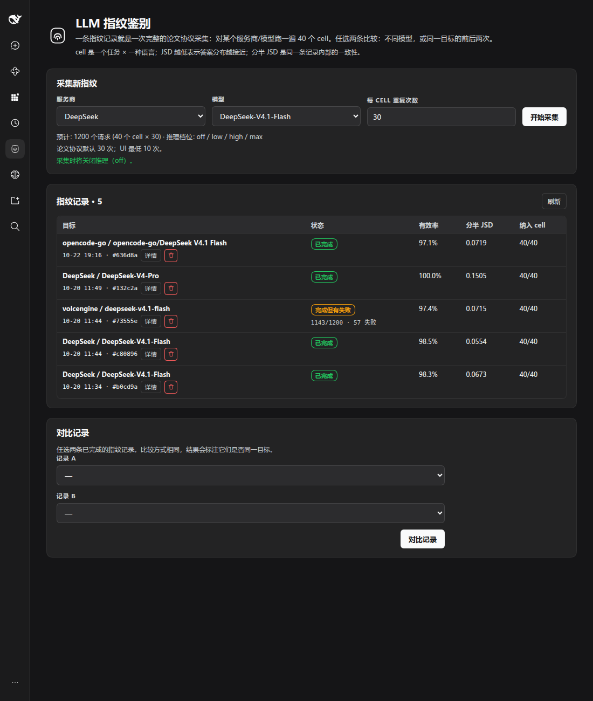

# dsh-fingerprint

面向 DeepSeek Harness（DSH）的论文协议 LLM 指纹采集与对比插件。



## 它做什么

dsh-fingerprint 把 DSH 里已经配置好的 `provider/model` 路由当作审计目标，用论文 *One Token Is Enough* 的 40-cell 单 token 探针 battery 采集一条指纹记录，然后可以任选两条记录做对比：

- 同一模型在不同服务商之间对比；
- 同一个服务商/模型的两次采集做前后对比；
- 同一服务商下不同模型对比。

一条记录包含 40 个 cell（10 个任务 × 4 种语言）× 30 次重复。插件保存原始响应，计算每个 cell 的答案分布、base-2 JSD、分半一致性，并用判定线 `0.280`（发布数据中不同模型距离的 1% 分位）给出“看起来是同一个模型 / 看起来不是同一个模型 / 证据不足”的结论。

插件不保存 provider API key；认证和请求路由由 DSH 的 `llm` 服务处理。无法关闭 reasoning 的模型会被硬拦截，因为论文协议需要一次直接的单次 completion。

## 要求

- 一个启用 Web GUI 的 DSH profile（需要 `llm`、`tools`、`webServer` 服务）。
- DSH 0.2.1 系列：实测 `0.2.1-rc.2` 和 `0.2.1-rc.4`，`engines.dsh` 限定 `>=0.2.1-rc.2 <0.2.2-0`。
- 至少一个配置好的、能关闭 reasoning（`off` / `none`）或本身不推理的 provider/model。
- Node.js（由 DSH 自带，无需单独安装）。

## 安装

### 从 npm 安装

```bash
dsh plugin --profile web add dsh-fingerprint
```

把 `web` 换成实际使用的 profile 名。安装后按 DSH 的提示重启，或刷新 Web GUI。

### 从 GitHub 安装

```bash
dsh plugin --profile web add github:Jerry2262/dsh-fingerprint
```

### 本地开发

克隆仓库，然后让 agent 调用 `plugin_manager` 的 `install_bundle`，`target` 指向仓库的绝对路径。

面板出现后，点击侧栏的指纹图标打开“LLM 指纹鉴别”。

## 使用

1. 选择服务商和模型。不能关闭 reasoning 的模型会置灰、不可选，并标注原因。
2. 设置每个 cell 的重复次数（默认 30，UI 最低 10），点“开始采集”。
3. 运行中的记录显示进度；完成后显示有效率、分半 JSD、纳入 cell 数。插件被卸载或进程重启时，未完成的记录会标为失败（保留已抓到的响应），可以直接删除，不会自动续跑。
4. 在“对比记录”里选两条记录，点“对比记录”。比较方式只有一种，结果会标注两边是否同一目标。
5. 结果包含差异分数、判定线、结论、关系、cell 级差异和警告。低于判定线只说明差异小，不等于 100% 是同一个模型。
6. 行内垃圾桶可以删除记录；删除前会二次确认。运行中的记录不能删除。

## Agent 工具

Host 服务同时暴露给 agent：

- `llm_fingerprint_list_models`
- `llm_fingerprint_probe`
- `llm_fingerprint_capture`
- `llm_fingerprint_get_record`
- `llm_fingerprint_compare`
- `llm_fingerprint_delete_record`

UI 和工具调用同一个 Host 服务，不维护第二套逻辑。

## 工作原理

一次采集使用论文的 10 个任务 × 4 种语言 = 40 个 cell，每个 cell 30 次，`temperature=1.0`，`max_tokens=16`，固定的单词 system prompt，关闭 reasoning。答案经过确定性归一化；两条记录的分数是双方有效样本都 ≥10 的 cell 上 base-2 JSD 的平均值。判定线 `0.280` 取自发布的分半 trial 中不同模型距离的 1% 分位；只有覆盖全部 40 个 cell 且两条记录都是每 cell 30 次重复时才给出判定，否则显示分数和覆盖情况，结论为“证据不足”。在这个工作点上，约 1% 的不同模型会低于线，约 18% 的同模型比较会高于线。

每次请求只包含论文的 system prompt 和一条 user 探针，不带对话历史、工具或当前会话的 system prompt。每个独立样本使用新的会话标识，同一样本重试沿用标识；标识经 DSH 适配器传递，不创建聊天会话。新标识不保证禁用服务商缓存，具体策略记录在新记录的 `request.sessionPolicy` 中。比较时，提示词版本不同或推理没有关闭的记录会被拒绝；会话标识策略不同只提示风险。

更详细的算法、数据模型和兼容性判断见 [docs/DESIGN.md](docs/DESIGN.md)。

## 数据与隐私

- 插件不保存 API key；key 留在 DSH 的 provider/credential 层。
- 原始响应和指纹默认写到 `$DSH_HOME/llm-fingerprint/`，也可以由插件 row 的 `dataDir` 覆盖。
- 删除记录会删除该目录下的 `meta.json`、`responses.jsonl` 和 `fingerprint.json`。
- 无法关闭 reasoning 的模型不会被静默采集。

## 限制

- 同模型跨服务商可能因为量化、推理实现、system prompt 不同而天然有差异；跨服务商对比是证据，不是证明。
- 判定线取不同模型距离的 1% 分位，仍会有约 1% 的不同模型落在线下，被判成“看起来是同一个模型”。
- 判定线和论文的 EER 都只适用于这套协议；修改 repetitions、提示词或 reasoning 设置后需要重新校准。
- 目前没有 post-reasoning 指纹模式；只能 reasoning 的模型会被拒绝。
- 插件审计的是 DSH 配置的整条路由；聚合器的上游路由和对方返回的 model 字符串不在 `ctx.llm.stream` 的可见范围内。
- 中断恢复假设同一个数据目录只由一个 DSH 进程写入；多个进程共用 `DSH_HOME` 时，后启动的进程会把另一个进程正在运行的记录标为失败。

## 开发

- `index.js`：Host plugin，`llm` / `webServer` service、agent tools、HTTP API。
- `core.js`：协议常量、提示词 battery、归一化、JSD、指纹与对比。
- `client.js`：Web 面板（`main` + `sidebar.panellist`）、详情抽屉、对比与删除确认。
- `prompts.json`：论文 paper-1 的 10 个任务 × 4 种语言。
- `locale/`：插件元数据和 UI 文案。
- `docs/DESIGN.md`：设计细节。
- `npm run check`：JS 语法检查（无构建步骤）。
- `npm test`：核心回归测试（判定线、覆盖门槛、协议拒绝、重复 cell 与主要答案）。

## 许可与来源

插件代码使用 MIT 许可，见 [LICENSE](LICENSE)。提示词和数据的来源、MIT/CC-BY-4.0 归属见 [NOTICE.md](NOTICE.md)。
